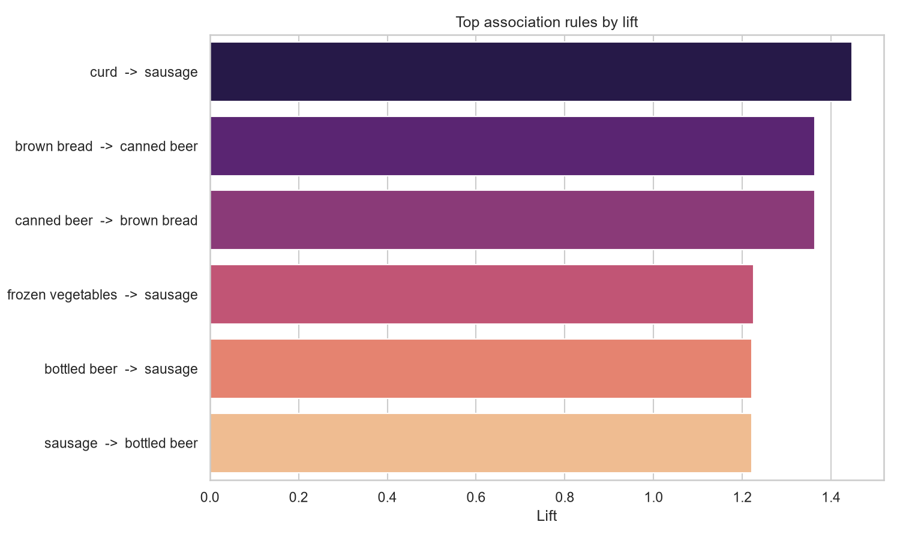
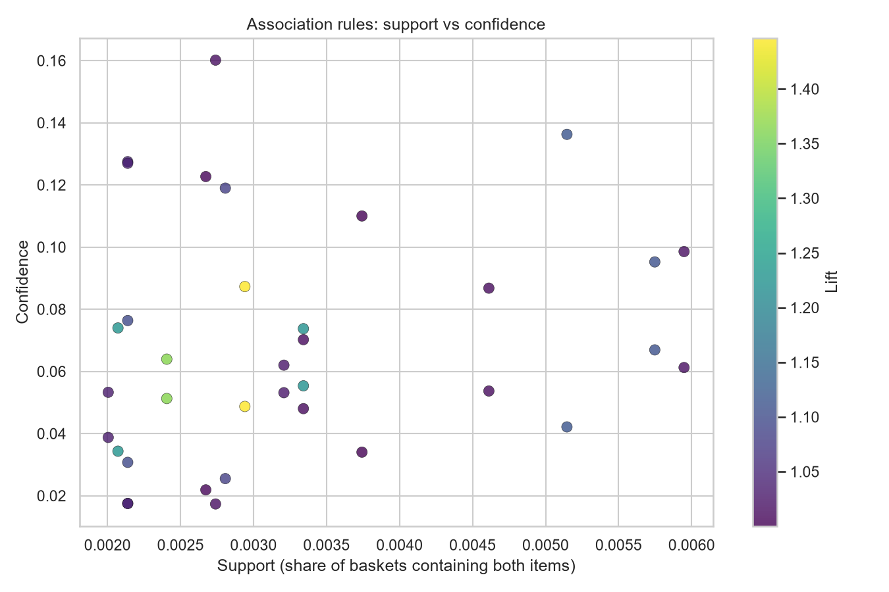
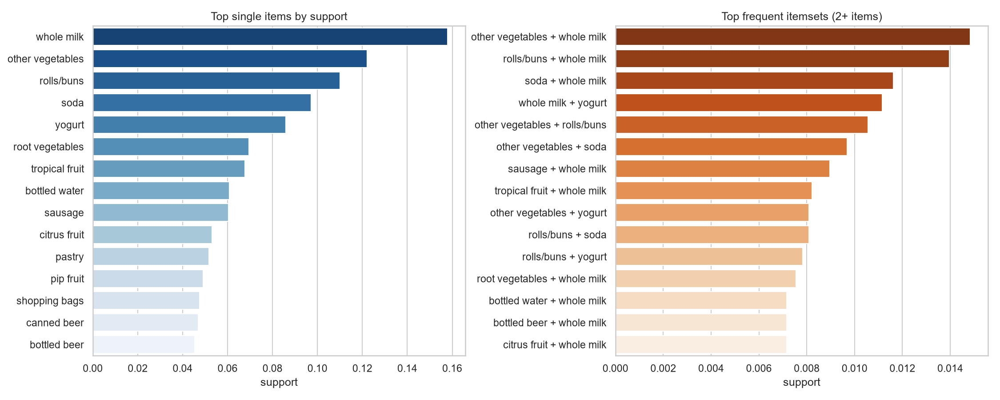
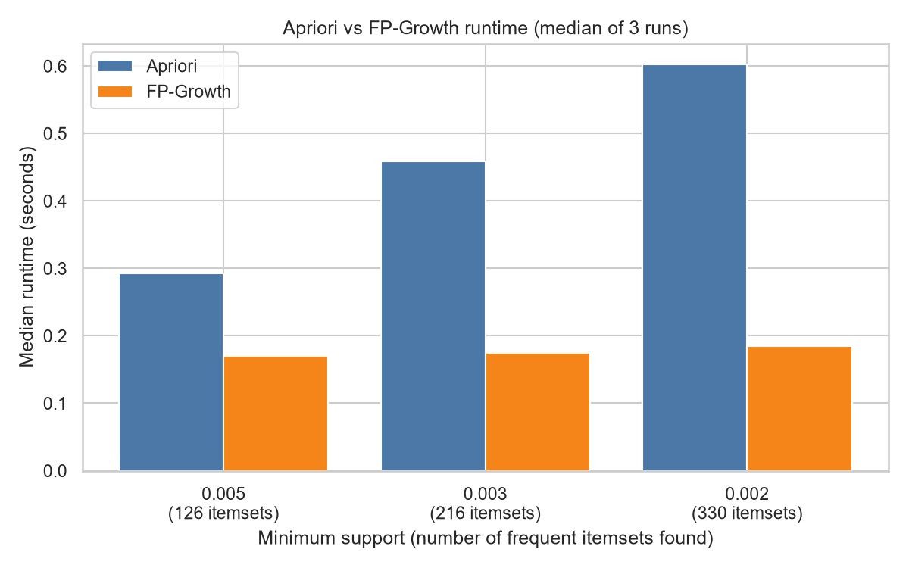

# Market Basket Analysis

Finding products that are frequently bought together in grocery transactions, to support cross-selling, bundling and store-layout decisions.

## Business problem
A grocery retailer wants to know which products are bought together so it can test bundles, "frequently bought together" prompts and shelf placement.

## Dataset
- **Source:** [Groceries Dataset on Kaggle](https://www.kaggle.com/datasets/heeraldedhia/groceries-dataset) (heeraldedhia), licensed **GPL 2** on Kaggle
- **Columns:** `Member_number`, `Date`, `itemDescription`
- **Transaction definition:** one customer on one date (the data has no invoice ID). This gives **14,963 baskets**.
- The CSV is not stored in this repo. `data/download_data.py` downloads it from Kaggle (no login was needed when tested).

## Features
- Data cleaning and basket construction
- Apriori and FP-Growth (mlxtend) on identical data and settings
- Support, confidence and lift for every rule
- Runtime comparison at three support thresholds
- 7 saved charts and 3 exported CSV files

## Tech stack
Python, pandas, numpy, mlxtend, matplotlib, seaborn, kagglehub

## Project structure
    data/download_data.py      downloads Groceries_dataset.csv into data/
    market_basket_analysis.py  full analysis
    images/                    charts created by the script
    strong_rules.csv           rules with confidence >= 0.05 and lift >= 1.2
    rules_all.csv              all 36 rules with lift > 1
    runtime_comparison.csv     Apriori vs FP-Growth timings
    requirements.txt

## How to run
Tested on Windows 10 with Python 3.14 and mlxtend 0.25.0.

    pip install -r requirements.txt
    python data/download_data.py
    python market_basket_analysis.py

Run the commands from the project folder. Charts and CSV files are created automatically.

## Metrics
- **Support:** share of baskets containing the itemset
- **Confidence (A -> B):** share of baskets with A that also contain B
- **Lift:** confidence divided by how often B appears overall. Above 1 means A and B appear together more than chance would predict.
- **Baskets:** number of baskets containing both A and B (support x 14,963)

## Results
Settings: minimum support 0.002 (about 30 baskets). This gives 330 frequent itemsets (126 single items, 204 pairs) and 36 rules with lift above 1.

Strong rules (confidence >= 0.05, lift >= 1.2):

| Rule | Support | Confidence | Lift | Baskets |
|---|---|---|---|---|
| curd -> sausage | 0.0029 | 0.087 | 1.45 | 44 |
| brown bread -> canned beer | 0.0024 | 0.064 | 1.36 | 36 |
| canned beer -> brown bread | 0.0024 | 0.051 | 1.36 | 36 |
| frozen vegetables -> sausage | 0.0021 | 0.074 | 1.23 | 31 |
| bottled beer -> sausage | 0.0033 | 0.074 | 1.22 | 50 |
| sausage -> bottled beer | 0.0033 | 0.055 | 1.22 | 50 |

## Apriori vs FP-Growth
Same data and settings, median of 3 runs, identical itemsets found in every case.

| Min support | Itemsets | Apriori (s) | FP-Growth (s) |
|---|---|---|---|
| 0.005 | 126 | 0.292 | 0.170 |
| 0.003 | 216 | 0.459 | 0.175 |
| 0.002 | 330 | 0.603 | 0.185 |

FP-Growth was faster at every threshold, and Apriori slowed down as the threshold dropped. All runs finished in under a second, so the difference is small on this dataset. Results depend on dataset size, support threshold, hardware and the mlxtend implementation, and come from one machine.

## Business insights and tests
| Observed rule | Possible use | Test | Success metric |
|---|---|---|---|
| curd -> sausage (lift 1.45, 44 baskets) | "Frequently bought together" prompt or bundle | A/B test: show the prompt to half of shoppers | Attachment rate of sausage in baskets with curd |
| brown bread <-> canned beer (lift 1.36, 36 baskets) | Place the items closer in store | Compare stores or weeks with and without the layout change | Sales of the second item, basket value |
| sausage with frozen vegetables and bottled beer (lift about 1.22, 31 to 50 baskets) | Joint promotion | Run the promotion in some stores only | Incremental revenue and margin |

## Limitations
- Associations are modest: confidence is only 5 to 9%, and each strong rule appears in 31 to 50 of 14,963 baskets. Treat them as hypotheses to test, not guaranteed wins.
- Association is not causation, and a high lift does not prove profitability. Margins and prices are not in the data.
- A transaction is a customer-date pair, not a real receipt, and the data covers a limited period.
- Many rules come in mirrored pairs (A -> B and B -> A) with the same lift.
- Thresholds (support 0.002, confidence 0.05, lift 1.2) are practical choices, not statistical tests.

## Troubleshooting
- `ModuleNotFoundError`: run `pip install -r requirements.txt`
- `Dataset not found`: run `python data/download_data.py`
- Download fails: get the CSV from the Kaggle page above and place it in `data/`